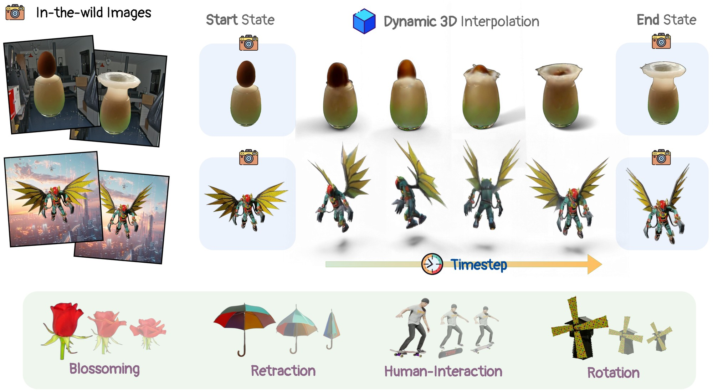

<div align="center">

<h1>In-2-4D: Inbetweening from Two Single-View Images <br> to 4D Generation </h1>

<div>
    <a href='https://sauradip.github.io/' target='_blank'>Sauradip Nag</a><sup>1</sup>&emsp;
    <a href='https://danielcohenor.com/' target='_blank'>Daniel Cohen-Or</a><sup>2</sup>&emsp;
    <a href='https://www2.cs.sfu.ca/~haoz/index.html' target='_blank'>Richard (Hao) Zhang</a><sup>1</sup>&emsp;
    <a href='https://www.sfu.ca/~amahdavi' target='_blank'>Ali Mahdavi Amiri</a><sup>1</sup>&emsp;
</div>
<div>
    <sup>1</sup>Simon Fraser University&emsp;
    <sup>2</sup>Tel Aviv University
</div>

<h3 align="center">
    SIGGRAPH ASIA 2025
</h3>

<h3 align="center">
  <a href="https://arxiv.org/abs/2504.08366" target='_blank'>Paper</a> |
  <a href="https://in-2-4d.github.io" target='_blank'>Project Page</a>
</h3>



</div>

### Abstract
We propose a new problem, In-2-4D, for generative 4D (i.e., 3D + motion) inbetweening from a minimalistic input setting: two single-view images capturing an object in two distinct motion states. Given two images representing the start and end states of an object in motion, our goal is to generate and reconstruct the motion in 4D. We utilize a video interpolation model to predict the motion, but large frame-to-frame motions can lead to ambiguous interpretations. To overcome this, we employ a hierarchical approach to identify keyframes that are visually close to the input states and show significant motion, then generate smooth fragments between them. For each fragment, we construct the 3D representation of the keyframe using Gaussian Splatting. The temporal frames within the fragment guide the motion, enabling their transformation into dynamic Gaussians through a deformation field. To improve temporal consistency and refine 3D motion, we expand the self-attention of multi-view diffusion across timesteps and apply rigid transformation regularization. Finally, we merge the independently generated 3D motion segments by interpolating boundary deformation fields and optimizing them to align with the guiding video, ensuring smooth and flicker-free transitions.

---

### News
- 2026.Oct.31: Novel-view video renderer (`./run.sh video`), selectable video backbone (Wan2.2 or LTX-Video),
  single-clip keyframe pinning for multi-condition video models.
- 2026.Oct.30: First end-to-end run on 4× Tesla T4 with the 4-step distilled video model (`configs/t4x4_distilled.yaml`).

### Install
The third-party code lives in git submodules under `third_party/`, pinned to the tested commits. It is never edited;
changes are applied at import time from `patches/`. The stages need conflicting pins, so there are three conda envs:
```bash
git clone https://github.com/sauradip/in24d.git && cd in24d
./run.sh setup              # fetches the submodules, then envs in24d_wan (steps 0-4, 9) / in24d_era3d (step 5) / in24d_4dgs (steps 6-9)
```

### Pretrained weights
Download all models with one script (files already present are skipped):
```bash
bash download_weights.sh                 # add --distilled for the 4-step Wan model, --ltx for the LTX-Video backbone
```
Large checkpoints (Wan2.2-I2V-A14B, SAM 2.1, Wan2.2-Lightning, LTX-Video) go to `checkpoints/`; Qwen2.5-VL-7B,
Stable Diffusion 2.1, Era3D, Depth-Anything-V2, CoTracker3 and the matting models go to the standard Hugging Face /
torch hub caches.

### Inference
Pick two images of the same object in its start and end state, on a plain background. We provide an example in the
`data_test` folder.

1. Generate the 4D object (all steps, s0-s9):
```sh
./run.sh flower data_test/flower/start.png data_test/flower/end.png
```
Faster, with the 4-step distilled video model (video sampling ~3 min instead of ~33 min per clip on 4× T4):
```sh
IN24D_CFG=configs/t4x4_distilled.yaml ./run.sh flower data_test/flower/start.png data_test/flower/end.png
```

2. Render novel-view videos (`outputs/flower/novel_view_videos/grid.mp4` and `orbit.mp4`):
```sh
./run.sh video flower --with_input --elevations 0 30
```

Finished steps are skipped, so an interrupted run continues with `./run.sh resume flower`. Useful options:
`--stages s6-s9` runs a subset, `--force` recomputes it, `--prompt "..."` overrides the motion caption,
`--set key=value ...` overrides any config value (one `--set` followed by all assignments).
Results for each case go to `outputs/<case>/`:
```
video/              inputs, motion caption, generated in-between video, motion progress, clips   (s0-s4)
multiview/          multi-view images of every clip frame                                         (s5)
4d/                 4D Gaussians (reconstruction/ merge/ refinement/), rendered views and metrics (s6-s9)
novel_view_videos/  grid.mp4 and orbit.mp4 from ./run.sh video
```

### Video backbone
The in-between video model is selected with `video.backbone`:

| backbone | conditioning | fragmentation (`hier.mode`) | config |
|---|---|---|---|
| `wan` (default) | first + last frame | `fragments`: non-linear motion is split at keyframes, each segment is regenerated as its own clip and the 4D fragments are merged | `configs/t4x4_distilled.yaml` |
| `ltx` | prompt + any number of frames pinned to frame indices | `pinned`: keyframes are pinned at their linear-progress frames in one clip, so there is always a single fragment | `configs/t4x4_ltx.yaml` |

```sh
IN24D_CFG=configs/t4x4_ltx.yaml ./run.sh flower data_test/flower/start.png data_test/flower/end.png
```
Clip length, fps, seed and the first/last-frame fidelity thresholds are shared by both backbones (`video:` in
`configs/default.yaml`); backbone-specific settings are under `wan:` and `ltx:`.

### Third-party code
Used as unmodified git submodules, each under its own license:
[Wan2.2](https://github.com/Wan-Video/Wan2.2) (Apache-2.0),
[LTX-Video](https://github.com/Lightricks/LTX-Video) (Apache-2.0),
[Era3D](https://github.com/pengHTYX/Era3D) (AGPL-3.0) and
[EG4D](https://github.com/jasongzy/EG4D) (4D Gaussian code).

### Citation
```bib
@article{nag2025in24d,
    title={In-2-4D: Inbetweening from Two Single-View Images to 4D Generation},
    author={Sauradip Nag and Daniel Cohen-Or and Hao Zhang and Ali Mahdavi-Amiri},
    journal={arXiv preprint arXiv:2504.08366},
    year={2025}
}
```
